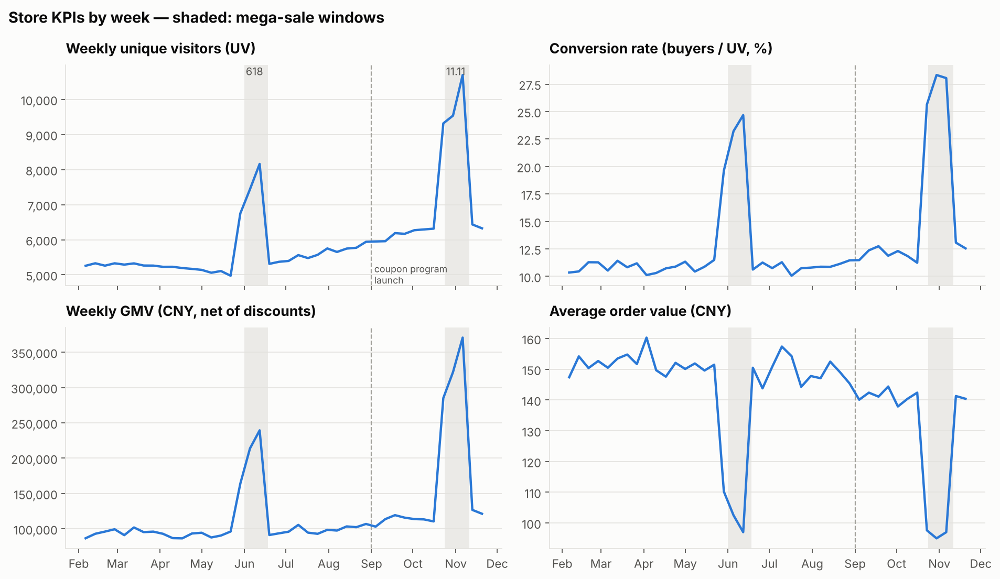
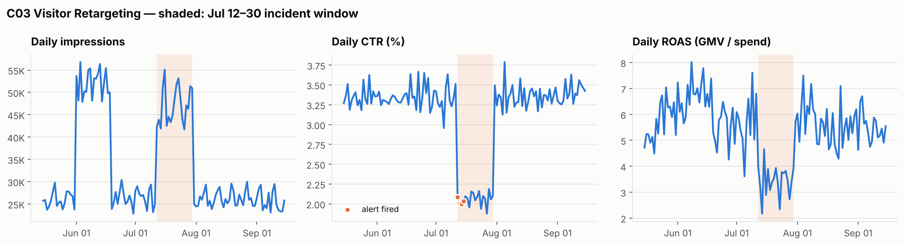
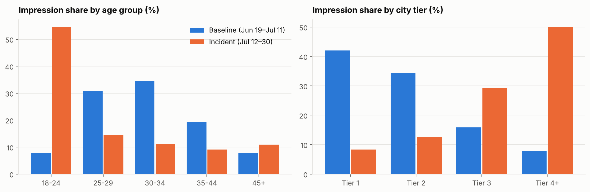
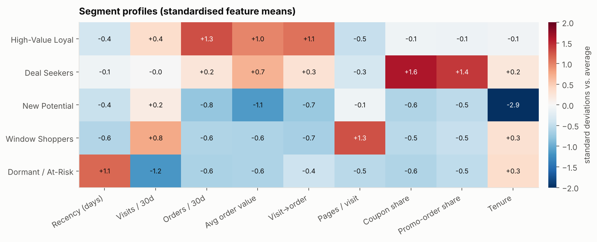
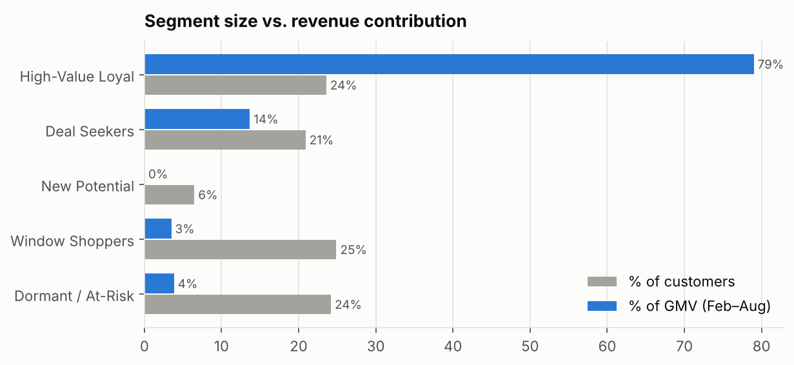
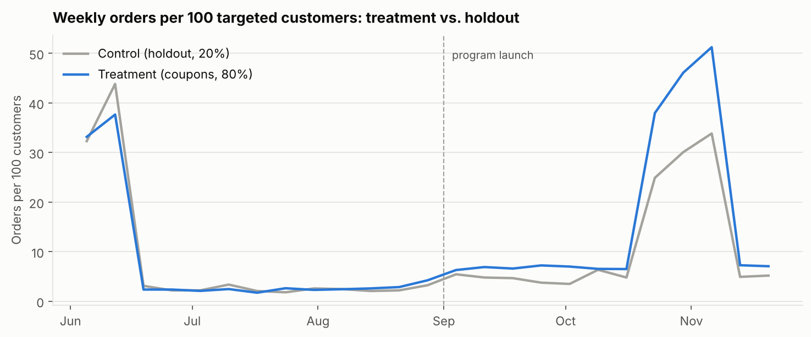

# E-commerce Growth Analytics: Campaign Diagnostics, Customer Segmentation & Coupon Experiment

**SQL (DuckDB) · Python (pandas, scikit-learn, statsmodels) · Tableau · Anomaly detection · K-means · A/B testing / DiD**

📊 **[Interactive Tableau dashboard & story](https://public.tableau.com/app/profile/xuerui.zhang4116/viz/E-commerceGrowthAnalytics/Story)**

> **Note on data:** This project recreates the kind of analysis I did as a Business Analyst at an e-commerce
> company in 2023. To respect confidentiality, **all data is synthetic**, generated by `src/generate_data.py`.
> Table structures are modelled on Alibaba's public *Ad Display/Click Data on Taobao.com* dataset and on
> typical marketplace "Business Advisor" store reports. No real company, customer or campaign data is used.

## TL;DR

| Question | Answer |
|---|---|
| **Why did paid performance drop in July?** | Campaign C03's audience targeting broke on Jul 12: impressions shifted to 18–24-year-olds (8% → 55%) and Tier 3/4+ cities (24% → 79%). **97% of the CTR drop (3.35% → 2.06%) is an audience-mix effect**, so creative and bids were not the cause. ROAS fell from 5.6 to 3.4, costing **≈ ¥47K GMV / ≈ 400 orders** in 19 days. A daily SQL alert would have caught it on day 1. |
| **Who should get targeted coupons?** | K-means on RFM + behaviour features found **5 segments**. *High-Value Loyal* customers are 24% of customers but **79% of GMV** and rarely need coupons. *Deal Seekers* and *New Potential* (recent sign-ups with no first order yet) were targeted. |
| **Did the coupon program work?** | In a randomized 80/20 holdout test, **orders per customer rose 49% (95% CI +37% to +63%)**, a DiD model gives +56%, and every ¥1 of extra discount returned **¥3.47 of incremental net GMV**. |

## Tableau dashboard

**Live version: [Tableau Public](https://public.tableau.com/app/profile/xuerui.zhang4116/viz/E-commerceGrowthAnalytics/Story)**, with three dashboards and a 5-page story
(KPIs → campaign incident → root cause → segments → experiment result).

The starting workbook [`tableau/ecommerce_growth_dashboard.twbx`](tableau/ecommerce_growth_dashboard.twbx) has three dashboards:
**Store KPIs**, **Campaign Diagnostics** and **Segments & Coupon Test**. They are built from tidy extracts in
`tableau/Data/` (CSV + Hyper extracts, which Tableau Public requires), and the workbook is regenerated by `python src/build_tableau.py`.

## Business questions & notebooks

| # | Notebook | Question |
|---|---|---|
| 01 | [`01_data_quality_and_kpis`](notebooks/01_data_quality_and_kpis.ipynb) | Is the data clean, and how are UV, conversion, GMV and AOV trending? |
| 02 | [`02_campaign_anomaly_root_cause`](notebooks/02_campaign_anomaly_root_cause.ipynb) | Which campaign broke in July, why, and what did it cost? |
| 03 | [`03_customer_segmentation`](notebooks/03_customer_segmentation.ipynb) | Which customer segments exist, and which should be targeted? |
| 04 | [`04_coupon_program_experiment`](notebooks/04_coupon_program_experiment.ipynb) | Did the segment-targeted coupon program increase orders, and was it profitable? |

---

## 1. KPI monitoring



- Data-quality checks found 800 duplicate log rows (removed), 604 refunded orders (excluded from GMV), and a
  campaign-day with spend but **zero clicks**, which turned out to be a tracking outage (see section 2).
- Traffic and GMV are dominated by the **618** and **Singles' Day** sales, when AOV drops sharply because of
  discounts. Week-over-week alerts must therefore be read against the promo calendar.
- **Favorites/Direct** visits convert best (18.9 orders per 100 visits); **Recommendation Feed** brings the most
  visits but converts worst (7.4).

## 2. Campaign anomaly root-cause

**Detection** (`sql/03_campaign_daily_anomalies.sql`): flag a day when CTR is ≥20% below the trailing 14-day
median *and* > 4 robust standard deviations (MAD) below it. Exactly two issues fire:

| Alert | Evidence | Diagnosis |
|---|---|---|
| C02 · Apr 15 | Impressions and spend normal, 0 clicks / visitors / orders | **Tracking outage**, a data problem. Clicks imputed (~1,144) instead of reporting a fake drop. |
| C03 · from Jul 12 | Impressions ↑, CTR −37 to −39% | **Real performance drop**, investigated below |



The drop starts and ends on specific days (it recovered on Jul 31), and other campaigns' CTR did not move,
which points to a **configuration change** rather than seasonality or creative fatigue.



**Shift-share decomposition** of the CTR change (−1.28 pts):

| Component | Effect on CTR (pts) |
|---|---|
| Mix effect (traffic moved to other audiences) | **−1.24** |
| Rate effect (same audiences clicked less) | +0.03 |
| Interaction | −0.07 |

**Root cause:** the audience targeting of the retargeting campaign changed (e.g. auto-expansion switched on
or a wrong audience package was attached). **Impact:** ¥21K spend at ROAS 3.4 instead of 5.6 ≈ **¥47K lost GMV**.

**Recommendations:** lock targeting on retargeting campaigns and require a second reviewer for audience
changes; keep the daily CTR-drop alert running; monitor tracking health separately.

## 3. Customer segmentation

Features (as of Aug 31, the decision date): recency, visit and order frequency, AOV, visit-to-order rate,
pages per visit, coupon share, promo-order share and tenure, with log transforms and standardisation.
k = 5 was chosen by silhouette score (`src/segmentation.py`).





| Segment | Profile | Action |
|---|---|---|
| High-Value Loyal | 24% of customers, 79% of GMV, AOV ≈ ¥151, rarely use coupons | Protect margin: no coupons, VIP perks instead |
| **Deal Seekers** | 80% of orders use coupons, 58% placed during mega-sales | **Target** with coupons |
| **New Potential** | Joined ~6 weeks ago, browsing but no first order yet | **Target** with a first-order coupon |
| Window Shoppers | Most visits and deepest browsing, almost never buy | Fix product pages / recommendations first |
| Dormant / At-Risk | No visit in ~3 months | Low-cost win-back messages |

*Validation:* because the data is synthetic, the generator's true customer types are known. The model
recovers them with an Adjusted Rand Index of 0.45. This check was used only after the model was final.

## 4. Coupon program experiment

On Sep 1, 3,768 customers in the two target segments were randomly split 80% treatment / 20% holdout.



| Metric (Sep 1 – Nov 30) | Treatment | Control | Lift | 95% CI |
|---|---|---|---|---|
| **Orders per customer** | 2.04 | 1.37 | **+49%** | +37% to +63% |
| Buyer rate | 75.5% | 66.4% | +14% | +8% to +20% |
| Net GMV per customer | ¥157 | ¥115 | +37% | +23% to +51% |
| Discount cost per customer | ¥24.6 | ¥12.5 | +97% | |

- **Difference-in-differences** (orders ~ treated × post, clustered SEs) controls for a small pre-launch gap
  and gives **+0.77 orders per customer (+56%)**, p < 0.001.
- The lift holds in both segments: Deal Seekers +51%, New Potential +46%.
- **ROI:** about 2,000 incremental orders and ¥126K incremental net GMV for ¥36K of extra discount, so
  **¥3.47 per ¥1**.
- **Next:** roll out to all target customers while keeping a small permanent holdout, and test a non-coupon
  intervention for Window Shoppers.

---

## Data (`data/raw/`, Feb 1 – Nov 30, 2023)

| File | Rows | Grain | Description |
|---|---|---|---|
| `customers.csv` | 15,000 | customer | Signup date, gender (~5% missing), age group, city tier, device, acquisition channel |
| `daily_user_behavior.csv` | ~401K | customer × day | Traffic source, page views, favorites, add-to-cart, orders (includes duplicate log rows) |
| `orders.csv` | ~42K | order | Category, items, gross / discount / net amount (CNY), coupon use, status |
| `campaigns.csv` | 8 | campaign | Name, channel, dates, daily budget |
| `ad_performance_daily.csv` | ~29K | day × campaign × age × city tier | Impressions, clicks, unique visitors, orders, spend, GMV |
| `coupon_program_assignment.csv` | 3,768 | customer | Segment at launch and treatment / control group |

Metric definitions: **CTR** = clicks / impressions · **CVR** = orders / clicks (ads) or buyers / UV (store) ·
**ROAS** = GMV / spend · **AOV** = net amount / orders.

`data/_answer_key_segments.csv` holds the generator's true customer types. It is used **only** for the final
validation in notebook 03.

### How the synthetic data was built
`src/generate_data.py` simulates daily visits and orders for 15,000 customers with five hidden behaviour
types, seasonality (618, Singles' Day) and paid campaigns broken down by audience. It plants the scenarios the
analysis has to find: a tracking outage, a targeting error, and a coupon program. The program is assigned the
same way the business would have done it: the generator runs the segmentation pipeline on Feb–Aug data,
picks the target segments, randomizes treatment and control, and only then simulates Sep–Nov.

## Reproduce

```bash
pip install -r requirements.txt
python src/generate_data.py                  # regenerate data/raw (fixed seed)
jupyter nbconvert --to notebook --execute --inplace notebooks/*.ipynb
```

## Project structure
```
├── data/raw/                     # synthetic CSVs
├── sql/                          # DuckDB queries: data quality, weekly KPIs, anomaly alert, audience mix, experiment
├── src/
│   ├── generate_data.py          # synthetic data generator
│   ├── segmentation.py           # feature engineering + K-means (shared by generator and notebook)
│   ├── db.py                     # loads CSVs as SQL views, runs sql/ files
│   ├── plot_style.py             # chart style
│   └── build_tableau.py          # Tableau extracts + workbook
├── tableau/                      # Tableau workbook (.twbx / .twb) and its data
├── notebooks/                    # 4 executed analysis notebooks
└── images/                       # charts used in this README
```
